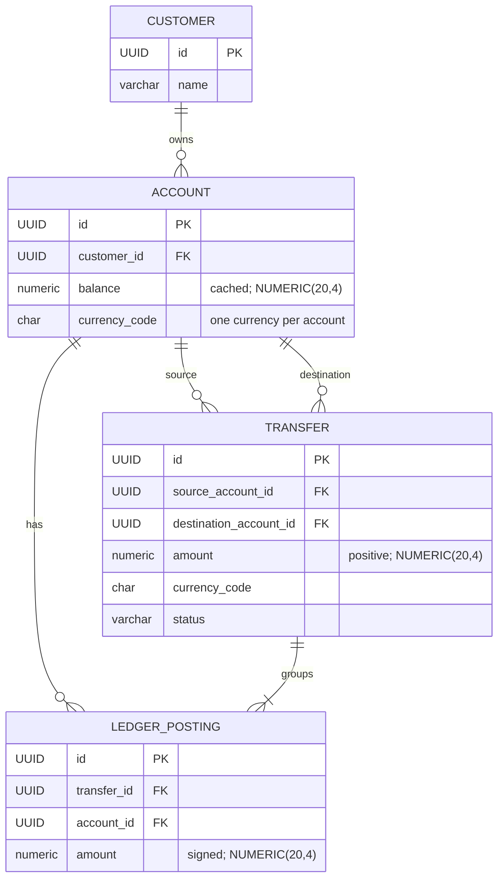

# Account-to-Account Transfer Design

This document describes proposed transfer features. It is a design proposal, not a description of completed application behavior. The first feature is a local account-to-account transfer; interbank transfers are a later extension and are not part of the first implementation.

## Scope

The first feature is an immediate account-to-account transfer in one currency. Posting records both sides of the movement in a double-entry ledger and updates both posted account balances atomically. Pending status is reserved for simulated external-bank funding; those incoming funds are not spendable until confirmation posts them. A later extension may model transfers between two independent deployments of this application as two simulated banks.

Currency conversion, real external payment networks, production deposits, withdrawals, fees, refunds, and authentication are outside this feature's current scope. Development will use a simulator to provide opening funds as if they came from an external bank.

## Future extension: transfers between simulated banks

The interbank simulator will use the same application code in two independently deployed server instances. Each instance represents a separate institution and owns a separate database, configuration, and ledger. The instances communicate through an API; they do not share a database or perform writes to each other's ledger. Deploying two copies against one database would not simulate independent banks.

An interbank transfer cannot be committed as one database transaction because each bank controls its own database. It therefore needs an explicit workflow spanning both systems. A proposed flow is:

1. The sending bank validates the request and reserves the requested funds so they cannot be spent by another transfer while the outcome is unresolved. The transfer is recorded as pending locally.
2. The sending bank sends a transfer instruction to the receiving bank, with a stable transfer identifier or idempotency key.
3. The receiving bank validates the instruction and records its decision. On acceptance, it posts the incoming credit exactly once; on rejection, it records the rejection without crediting the account.
4. The sending bank records the receiving bank's result. It settles the outgoing debit when accepted, or releases the reservation when rejected.

The exact reservation representation is open. It could be a separate reserved balance or another mechanism that reduces available funds without prematurely changing the posted ledger balance. The implementation must define how timeouts and retries work: a missing response does not prove that the receiving bank failed to process the instruction. Repeating a request must not create another credit, and the banks need a way to query or reconcile an operation whose result is unknown. Any final posted entries remain immutable; corrections use compensating entries.

This setup models separate ownership of balances, API communication, and common distributed-processing failures such as lost responses and retries. It does not by itself model real payment networks, clearing, or settlement rules.

## Account model

- A **Customer** owns zero or more **Accounts**. Wallets are not part of the first-version model.
- Each **Account** represents one user balance in exactly one currency.
- A user may hold accounts in multiple currencies, with at most one account per currency. The proposed database schema enforces this with a unique constraint on `(customer_id, currency_code)`.
- Each account stores a cached posted balance for fast reads. The proposed money representation is PostgreSQL `NUMERIC(20,4)` with a currency code; currency-specific scale validation occurs in the application. See [ADR-0001](../adr/0001-store-monetary-amounts-as-exact-decimals.md).
- Pending simulated external funding does not increase an account's posted or available balance. Internal user-to-user transfers post immediately, so outgoing transfer reservations are not part of the initial model.
- Ledger postings preserve the account's posted-balance history. They are not summed on every transfer. Posted balances are updated with the postings in the same database transaction and can be verified or repaired from those postings if a discrepancy is detected.

## Conceptual ERD

The diagram shows the proposed internal-transfer relationships. It is not a final physical schema; identifiers and lifecycle fields may change during implementation. The entity used to track simulated external funding, including whether it shares the `Transfer` entity, remains undecided and is not shown.

## Transfer example

If account A transfers EUR 10.00 to account B, one posted transfer groups two ledger postings:

| Account | Currency | Posting | Balance impact |
| --- | --- | --- | ---: |
| A | EUR | Debit | -10.00 |
| B | EUR | Credit | +10.00 |
| **Net change** | **EUR** |  | **0.00** |

For a fee-free transfer, the source account’s cached balance decreases by EUR 10.00 and the destination account’s cached balance increases by EUR 10.00. Fees are outside the initial scope; adding one would require an additional ledger posting.

## Transfer and funding lifecycle

An internal user-to-user transfer posts immediately after validation and a successful funds check. The transfer, its two ledger postings, and both cached posted-balance updates are written in one database transaction. Either all changes commit or none do.

Opening funds for development are represented as simulated external-bank funding. That funding may remain pending until an explicit simulated confirmation. While pending, it creates no posted ledger entries and does not increase the user's posted or available balance. On confirmation, the funding operation posts the user credit and its matching ledger entry atomically. A failed or rejected funding operation creates no posted entries.

The ledger postings are the durable history used to explain posted balances and to verify or repair a cached balance if a discrepancy is detected. Recalculating a balance from the full history is not part of the ordinary transfer path.

Posted ledger history is immutable. A correction is represented by a new linked transaction rather than editing or deleting posted entries.

## Core ledger and processing guarantees

- **Atomicity:** a posted operation and its ledger postings and cached balance changes commit or roll back together.
- **Idempotency:** retrying the same request with the same key does not create a duplicate; reusing the key with different request data is rejected.
- **Immutable posted history:** corrections use new linked transactions.
- **Balanced postings:** postings for a transfer sum to zero within that currency.

## Initial transfer constraints

- **Same-currency transfer:** source and destination accounts have the same currency; both postings use that currency.
- **Positive amount:** the requested amount is greater than zero and uses exact decimal arithmetic.
- **Currency scale:** the amount does not exceed the permitted fractional scale for its currency.

## Security requirement

- **Authorization:** once authentication is implemented, the server verifies that the caller may initiate a debit from the source account and that the destination account is valid and eligible to receive the transfer. The caller does not need access to or ownership of the destination account.

## Current decisions

- **Initial currencies:** EUR is supported first. USD and GBP are planned follow-ons; each enabled currency will have an explicit allowed scale.
- **Insufficient funds:** Negative balances are disallowed initially.
- **Idempotency:** The same key and same request return the existing operation result; reusing the key with different request data is rejected. A retry of pending simulated funding returns its pending result.
- **Pending behavior:** Internal transfers post immediately. Simulated external-bank funding can remain pending and is not spendable until confirmed and posted.
- **Opening funds for development:** Test opening funds are represented as if received from an external bank, without a real bank integration.
- **Future interbank simulation:** Use the same application code in two independent server deployments, each with its own database and ledger. Interbank transfers will use an API and a separate pending workflow; they will not be treated as atomic local transfers.

## Decisions still open

- **Account provisioning:** Is a default EUR account created with each user, or only when an account is requested?
- **Funding model:** Does simulated funding use the `Transfer` entity or a separate funding entity, and how are its external-funding ledger accounts represented?
- **Concurrent funds checks:** How are simultaneous internal transfers serialized or rejected to prevent spending the same funds twice?
- **Idempotency policy:** What is the key's scope and retention period?
- **Balance reconciliation:** What detects a mismatch between cached balances and ledger postings, and how is a repair reviewed and applied?
- **Funding confirmation:** What interface or process simulates external-bank confirmation, and how are pending funding operations rejected or cancelled?
- **Interbank transfer identity and idempotency:** How are transfer identifiers scoped across banks, and how long must each bank retain idempotency records?
- **Interbank reservations and lifecycle:** How are funds reserved, which states and transitions are supported, and when is a reservation released or converted to a posted debit?
- **Unknown outcomes and reconciliation:** How does the sending bank resolve a timeout after the receiving bank may have accepted the request (for example, status lookup, retry, or manual reconciliation)?
- **Interbank protocol and trust:** How are bank instances identified and authenticated, and what request, response, and rejection details make up the API contract?
- **Settlement model:** Does acceptance by the receiving bank represent final settlement in this simulator, or is a later settlement step needed?

## Acceptance criteria for implementation

- A successful transfer creates one transfer with balanced postings and updates both cached balances.
- An internal transfer posts immediately, creating both ledger postings and updating both cached balances atomically.
- Pending simulated funding does not change the user's posted or available balance before confirmation.
- Confirming simulated funding creates the user credit and matching external-funding posting atomically; rejecting it creates no posted entries.
- Invalid input creates no transfer, postings, or balance changes.
- A failure during processing leaves no partial transfer effect.
- A matching retry with the same idempotency key does not create a duplicate.
- Concurrent transfers cannot violate the selected insufficient-funds rule.
- Verification covers successful transfers, rejected transfers, retries, and concurrent requests.

Interbank acceptance criteria will be defined when that extension is designed. At minimum, they must cover independent databases, duplicate delivery, lost responses, receiver rejection, sender restart or retry, and reconciliation of an unknown outcome without duplicate credits or spending reserved funds.
