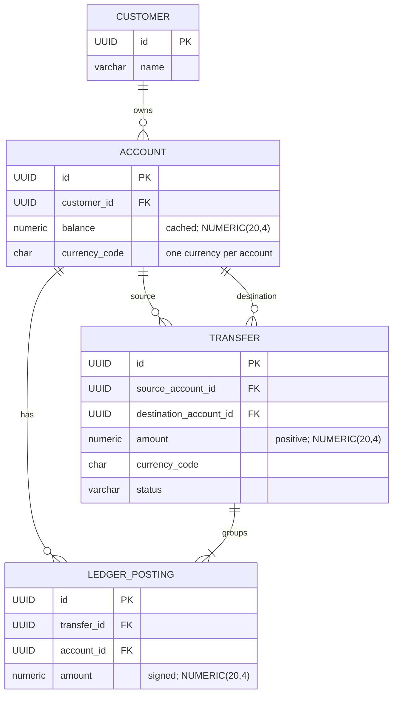

# Account-to-Account Transfer Design

This document describes the proposed first ledger feature. It is a design proposal, not a description of completed application behavior.

## Scope

The first feature is an immediate account-to-account transfer in one currency. Posting records both sides of the movement in a double-entry ledger and updates both posted account balances atomically. Pending status is reserved for simulated external-bank funding; those incoming funds are not spendable until confirmation posts them.

Currency conversion, real external payment networks, production deposits, withdrawals, fees, refunds, and authentication are outside this feature's current scope. Development will use a simulator to provide opening funds as if they came from an external bank.

## Account model

- A **Customer** owns zero or more **Accounts**. Wallets are not part of the first-version model.
- Each **Account** represents one customer balance in exactly one currency.
- A customer may hold accounts in multiple currencies, with at most one account per currency. The proposed database schema enforces this with a unique constraint on `(customer_id, currency_code)`.
- Each account stores a cached posted balance for fast reads. The proposed money representation is PostgreSQL `NUMERIC(20,4)` with a currency code; currency-specific scale validation occurs in the application. See [ADR-0001](../adr/0001-store-monetary-amounts-as-exact-decimals.md).
- Pending simulated external funding does not increase an account's posted or available balance. Internal customer-to-customer transfers post immediately, so outgoing transfer reservations are not part of the initial model.
- Ledger postings preserve the account's posted-balance history. They are not summed on every transfer. Posted balances are updated with the postings in the same database transaction and can be verified or repaired from those postings if a discrepancy is detected.

## Conceptual ERD

The diagram shows the proposed internal-transfer relationships. It is not a final physical schema; identifiers and lifecycle fields may change during implementation. The entity used to track simulated external funding, including whether it shares the `Transfer` entity, remains undecided and is not shown.

## Transfer example

If account A transfers EUR 10.00 to account B, one posted transfer groups two ledger postings:

| Account | Currency | Posting | Balance impact |
| --- | --- | --- | ---: |
| A | EUR | Debit | -10.00 |
| B | EUR | Credit | +10.00 |
| **Net change** | **EUR** |  | **0.00** |

For a fee-free transfer, the source account’s cached balance decreases by EUR 10.00 and the destination account’s cached balance increases by EUR 10.00. Fees are outside the initial scope; adding one would require an additional ledger posting.

## Transfer and funding lifecycle

An internal customer-to-customer transfer posts immediately after validation and a successful funds check. The transfer, its two ledger postings, and both cached posted-balance updates are written in one database transaction. Either all changes commit or none do.

Opening funds for development are represented as simulated external-bank funding. That funding may remain pending until an explicit simulated confirmation. While pending, it creates no posted ledger entries and does not increase the customer's posted or available balance. On confirmation, the funding operation posts the customer credit and its matching ledger entry atomically. A failed or rejected funding operation creates no posted entries.

The ledger postings are the durable history used to explain posted balances and to verify or repair a cached balance if a discrepancy is detected. Recalculating a balance from the full history is not part of the ordinary transfer path.

Posted ledger history is immutable. A correction is represented by a new linked transaction rather than editing or deleting posted entries.

## Core ledger and processing guarantees

- **Atomicity:** a posted operation and its ledger postings and cached balance changes commit or roll back together.
- **Idempotency:** retrying the same request with the same key does not create a duplicate; reusing the key with different request data is rejected.
- **Immutable posted history:** corrections use new linked transactions.
- **Balanced postings:** postings for a transfer sum to zero within that currency.

## Initial transfer constraints

- **Same-currency transfer:** source and destination accounts have the same currency; both postings use that currency.
- **Positive amount:** the requested amount is greater than zero and uses exact decimal arithmetic.
- **Currency scale:** the amount does not exceed the permitted fractional scale for its currency.

## Security requirement

- **Authorization:** once authentication is implemented, the server verifies that the caller may initiate a debit from the source account and that the destination account is valid and eligible to receive the transfer. The caller does not need access to or ownership of the destination account.

## Current decisions

- **Initial currencies:** EUR is supported first. USD and GBP are planned follow-ons; each enabled currency will have an explicit allowed scale.
- **Insufficient funds:** Negative balances are disallowed initially.
- **Idempotency:** The same key and same request return the existing operation result; reusing the key with different request data is rejected. A retry of pending simulated funding returns its pending result.
- **Pending behavior:** Internal transfers post immediately. Simulated external-bank funding can remain pending and is not spendable until confirmed and posted.
- **Opening funds for development:** Test opening funds are represented as if received from an external bank, without a real bank integration.

## Decisions still open

- **Account provisioning:** Is a default EUR account created with each customer, or only when an account is requested?
- **Funding model:** Does simulated funding use the `Transfer` entity or a separate funding entity, and how are its external-funding ledger accounts represented?
- **Concurrent funds checks:** How are simultaneous internal transfers serialized or rejected to prevent spending the same funds twice?
- **Idempotency policy:** What is the key's scope and retention period?
- **Balance reconciliation:** What detects a mismatch between cached balances and ledger postings, and how is a repair reviewed and applied?
- **Funding confirmation:** What interface or process simulates external-bank confirmation, and how are pending funding operations rejected or cancelled?

## Acceptance criteria for implementation

- A successful transfer creates one transfer with balanced postings and updates both cached balances.
- An internal transfer posts immediately, creating both ledger postings and updating both cached balances atomically.
- Pending simulated funding does not change the customer's posted or available balance before confirmation.
- Confirming simulated funding creates the customer credit and matching external-funding posting atomically; rejecting it creates no posted entries.
- Invalid input creates no transfer, postings, or balance changes.
- A failure during processing leaves no partial transfer effect.
- A matching retry with the same idempotency key does not create a duplicate.
- Concurrent transfers cannot violate the selected insufficient-funds rule.
- Verification covers successful transfers, rejected transfers, retries, and concurrent requests.
